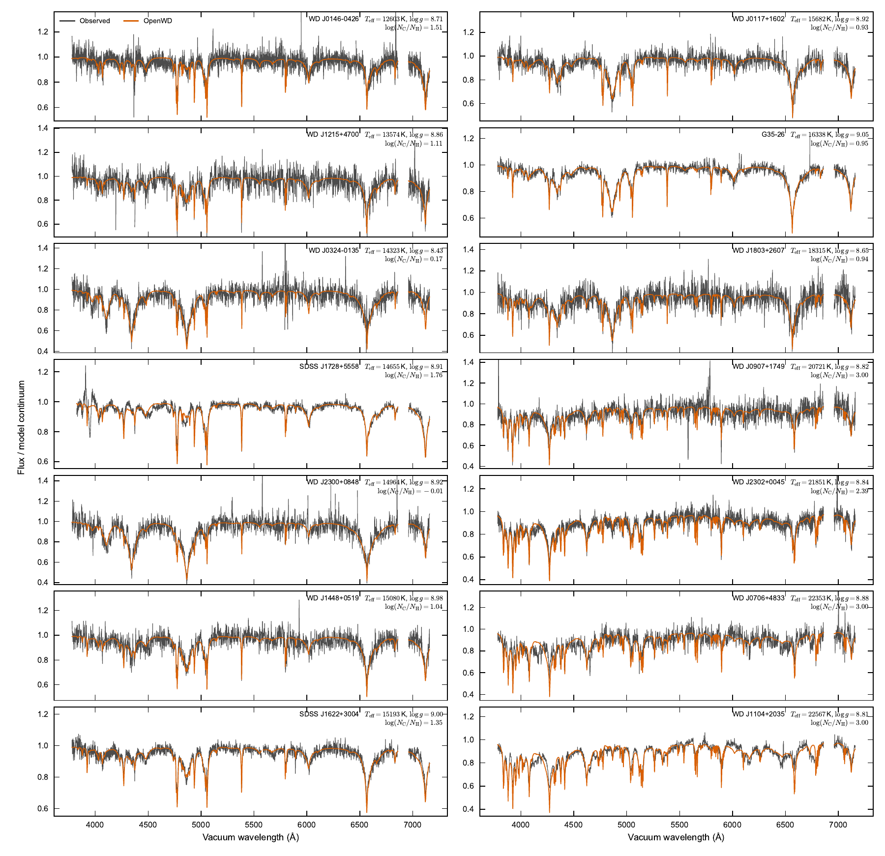
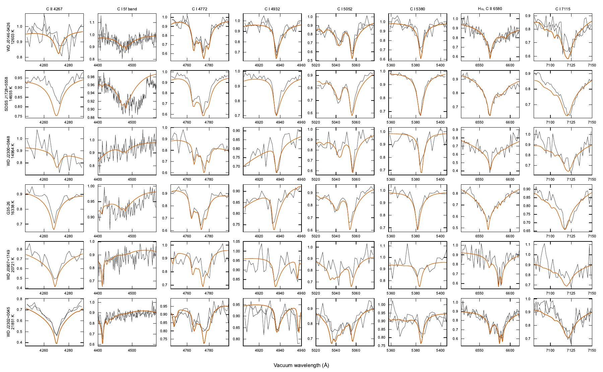
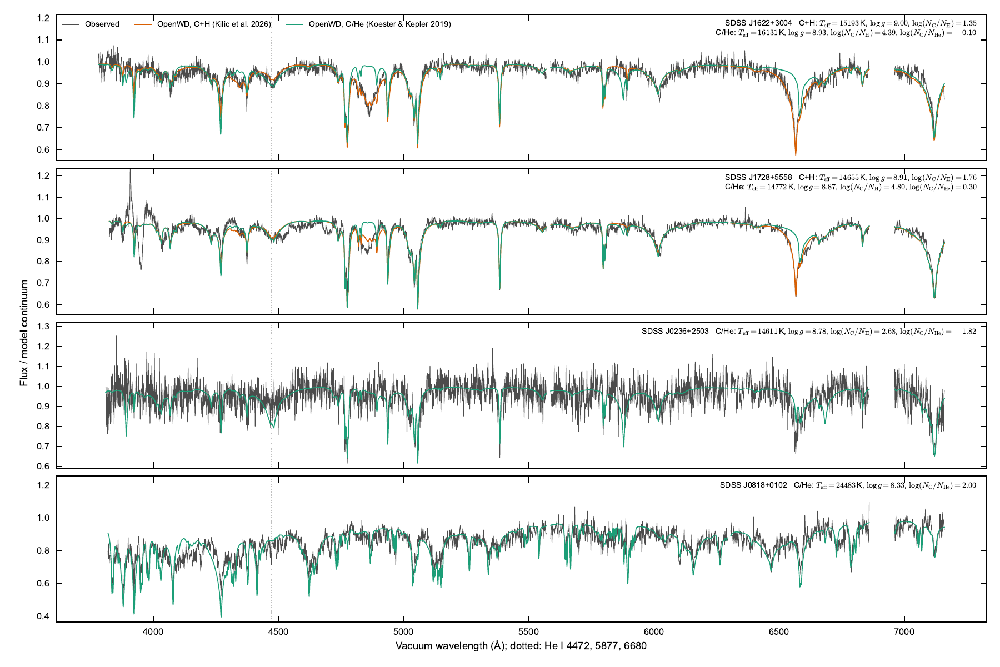

# Warm and hot DQ: carbon atmospheres with hydrogen and helium

[Model guide](README.md) · [Getting started](../getting-started.md)

`WarmDQConfig` computes LTE atmospheres made of carbon with hydrogen, helium
or both. Such atmospheres occur in warm DQ, DAQ and hot DQ white dwarfs (Teff
of about 11,000–25,000 K, masses near 1 M☉ and above). Carbon, hydrogen,
helium and any added element all contribute to the pressure, the charge
balance, the mass and the opacity.
A magnetic field can be added to the emergent spectrum. OpenWD does not fit
observations.

All data are bundled; see [Getting started](../getting-started.md) for the
installation.

## Run a model

```python
from wd_spectra import WarmDQConfig, run_model

run = run_model(
    WarmDQConfig(
        effective_temperature=15_000, logg=8.9,
        log_carbon_to_hydrogen=1.0,       # log10 N(C)/N(H)
        log_carbon_to_helium=None,        # log10 N(C)/N(He); None: no helium
    ),
    "results/warm-dq",
    require_convergence=True,
)
spectrum = run.spectrum  # vacuum wavelength (Å), surface F_lambda
```

A standard-quality cold start takes 1.2–2.7 hours on one core. The default
spectrum covers 3500–9900 Å in 0.2 Å steps. Give `wavelength=` to
`run_model` for a different grid.

## Options

| Option | Default | Effect |
| --- | --- | --- |
| `effective_temperature`, `logg` | 13574 K, 8.86 | Stellar parameters. The defaults are WD J1215+4700 (Kilic et al. 2026). |
| `log_carbon_to_hydrogen` | 1.11 | log10 N(C)/N(H). `None` removes hydrogen. |
| `log_carbon_to_helium` | `None` | log10 N(C)/N(He). `None` removes helium. |
| `trace_abundances` | `{}` | log10 N(X)/N(C) of other elements, for example `{"O": -1.0}`. |
| `quality` | `"standard"` | `"quick"` (24 depths), `"standard"` (48 depths), `"production"` (72 depths). |
| `mixing_length_alpha` | 1.25 | ML2 convection parameter. `None` gives a radiative atmosphere. |
| `structure_maximum_metal_lines`, `formal_maximum_metal_lines` | `None` (25,000) | Line budgets of the structure and the spectrum. |
| `magnetic_field_megagauss` | 0 | Field strength. Zero gives the nonmagnetic spectrum. |
| `field_geometry` | `"dipole"` | `"dipole"` (offset dipole) or `"uniform"`. |
| `field_strength_definition` | `"dipole-polar"` | `"dipole-polar"` or `"visible-mean"`, as in `DAHConfig`. |
| `dipole_inclination_deg`, `dipole_offset_radius` | 60, (0, 0, 0) | Dipole axis inclination and displacement in stellar radii. |
| `field_angle_deg` | `None` | Angle between a uniform field and the line of sight. `None` is isotropic. |
| `disk_field_bins` | 21 | Number of field-strength bins over the visible disk. |
| `include_diamagnetic_shift` | `True` | First-order quadratic Zeeman shift of the metal lines. |
| `magnetic_convection_suppression` | `True` | Use a radiative atmosphere when the mean visible field is 0.05 MG or stronger. |

## Physics

- **Equation of state.** The bulk-mixture closure of the [D6](D6.md) class:
  multi-element Saha balance with charge neutrality. Hydrogen and helium
  join the same closure. Their partition functions are the Hummer & Mihalas
  (1988) occupation-probability sums of the [DA](DA.md) and [DB](DB.md)
  classes, with the Q-MHD microfield distribution (Nayfonov et al. 1999) and
  neutral H and He as hard-sphere perturbers. In the helium-dominated limit
  the populations, c_P and ∇ad agree with the DB equation of state to
  better than 10⁻³. ML2 convection uses the derivatives of the same EOS.
  The fluid is ideal; the dense-helium corrections of the cool DB and DQ
  classes (He-REOS, dense He⁻ free–free) are not applied.
- **Carbon continuum and lines.** As in D6: level-resolved Opacity Project
  cross sections for C I and C II, Verner et al. (1996) fits for higher
  stages, free–free absorption, electron scattering, and the Atomic Line
  List v3 lines of C I–III with Q-MHD dissolution of the Rydberg lines.
- **Transition probabilities.** Lines with a NIST ASD value (1150–9000 Å;
  Kramida et al. 2024) use that value: accuracy grade D or better for C I,
  every grade for C II. The Atomic Line List values of the C II
  2s2p(³P°)nl system are 4–20 times larger than the NIST values (f = 2.45
  against 0.36 for 3d ⁴D°₃/₂–4f ⁴F₅/₂ at 4075 Å), exceed the sum rule and
  give strong spurious lines near 3877 and 4076 Å. A grade-E NIST value
  (uncertainty above 50%) is far closer than such a value. C I lines between
  states of the MCDHF calculation of Li et al. (2021) with a length–velocity
  difference up to 20% (741 lines) then take its oscillator strengths. For
  the 2p3s–2p4p array, NIST combines the Hibbert et al. (1993) singlet values
  with triplet values renormalized by 0.71–0.78; Li et al., the arc
  measurements of Jones & Wiese (1984) and the solar C I 4775.9 Å line all
  put the singlets 0.17–0.24 dex weaker relative to the triplets, and so do
  the warm DQ spectra (C I 4932, 5052 and 5380 against 4771).
- **Carbon line broadening.** Voigt profiles. The C I 3s–4p multiplets
  (4771, 4817, 4932, 5052 and 5380 Å) take measured Stark widths and red
  shifts (Konjević & Wiese 1990; Konjević et al. 2002; measured at
  n_e = 0.1–0.8 × 10¹⁷ cm⁻³ and 9000–11,600 K, scaled linearly with n_e).
  Eight C II multiplets (6580, 3920, 7234, 4267, 5145, 5650, 2837 and
  2511 Å) take semiclassical widths and shifts from STARK-B (Larbi-Terzi
  et al. 2012), with their temperature dependence. The shift moves each
  depth's profile by its own amount. Other C I lines take the
  nearest-level semiclassical width of Freudenstein & Cooper (1978), from
  the tabulated term energies and Coulomb-approximation radial integrals.
  For the measured C I multiplets it gives 1.34 times the laboratory widths
  (scatter 0.17 dex), against 0.72 times (0.39 dex) for the Kurucz
  constants, which for lines to high levels are up to twenty times too
  small. Lines of other ions use the Kurucz electron Stark constants; a
  multiplet member without one takes the median of its multiplet, and a
  line without any uses the classical estimate. Nearly hydrogenic Rydberg
  lines use the quasi-static ionic Stark profile of D6. The C I nf levels,
  which Stout writes in jK coupling, join the n-manifold of the LS levels
  of their parent term and of the jK levels of their own parent J (the
  ionic field does not change the core state), so the 2s2p³ ³D°–nf lines
  are Stark-mixed with nd as well (other classes keep the previous
  grouping).
- **C I 2s2p³ ³D°–nf series.** Stout has the 4f members (5013–5043 Å,
  NIST grade C) but no line to 5f–8f and no nf level built on the C II
  ²P°₁/₂ parent. The missing levels are placed with the quantum defect of
  their 4f member (this reproduces the tabulated nf levels to 6 cm⁻¹), and
  the lines take the 4f oscillator strengths scaled by n*⁻³ and the
  transition energy. Their Stark-broadened 5f members (4462–4480 Å) produce
  the broad absorption seen at 4430–4540 Å in warm and hot DQs.
- **Hydrogen opacity.** As in DA: H I bound–free with the dissolved-level
  pseudo-continuum, free–free, H⁻, and the Lyman, Balmer, Paschen and
  Brackett lines with the Tremblay & Bergeron (2009) Stark profiles. With
  helium present the Balmer lines also include neutral-helium broadening.
- **Helium opacity.** As in DB: He I bound–free (Opacity Project terms,
  Rydberg shells and the dissolved-level pseudo-continuum), He II bound–free,
  He⁺ and He²⁺ free–free, He⁻ free–free, the optical He I lines with the
  Beauchamp et al. Stark profiles, the He I resonance series and the He II
  lines. Neutral helium also broadens the carbon lines (van der Waals).
- **Structure.** The shared adaptive Newton solver relaxes the atmosphere and
  checks all-depth flux and local energy balance.
- **Magnetic field.** The field changes only the line opacity of the emergent
  spectrum. The structure, the level populations and the continuum are
  nonmagnetic.
  - *Metal lines.* Each LS multiplet is diagonalized as a whole in the field
    (fine structure from the tabulated level energies, plus the linear Zeeman
    term), which gives the Paschen–Back pattern at any field strength. The
    summed gf of the multiplet is conserved. The first-order diamagnetic
    energy of the outer electron is added with a hydrogenic ⟨r²⟩.
    Intercombination lines and levels without an LS label use the linear
    pattern of their own J levels.
  - *Rydberg lines.* Lines with a quasi-static Stark profile keep it and are
    translated to the three components of a normal triplet.
  - *Balmer lines.* The [DAH](DAH.md) components: normal triplets up to 1 MG
    and the H2db components above. Other hydrogen series and the helium
    lines are not split.
  - *Transfer.* One ray per surface cell with the Stokes-I opacity of its
    field strength and field–ray angle, summed over the visible disk.

## Validation

All comparisons use published parameters; nothing stellar is refit. Each
model is a cold start of `run_model` at standard quality with the class
defaults (48 depths, 25,000 structure and spectrum lines, ML2 α = 1.25). Only
a radial velocity and, per spectrum, a degree-5 multiplicative Chebyshev
polynomial (flux calibration, reddening and solid angle) are adjusted. The
model is averaged over each pixel and multiplied by the DESI resolution
matrix, or convolved with the SDSS `wdisp` dispersion. The figures divide data
and model by the same polynomial times the model's line-free continuum, so
they show flux relative to the model continuum. Telluric bands are excluded,
and DESI spectra are drawn in 2 Å bins.

- **C+H.** Kilic et al. (2026) fitted the DESI DR1 DQs with helium-free C+H
  models: spectroscopic Teff and log C/H, and log g from the Gaia parallax.
  log C/H = 3.00 is the edge of their grid (no hydrogen detected). Twelve
  stars have DESI spectra; for SDSS J1622+3004 and SDSS J1728+5558 the
  SDSS spectra have higher signal-to-noise.
- **C/He.** Koester & Kepler (2019) fitted SDSS warm DQs with C/He models
  containing trace hydrogen ([H/He] = −4.5) and hot DQs with [C/He] = 2,
  using photometric Teff and log g.

### Fourteen warm and hot DQs

[](../assets/warm-dq-paper.pdf)

DESI and SDSS spectra (gray) and OpenWD models (orange) at the C+H parameters
of Kilic et al. (2026), sorted by Teff (12,600–22,600 K, log g 8.43–9.05,
log C/H −0.01 to 3.00). The models reproduce the C I and C II lines, the
broad C I 5f band near 4480 Å and the Balmer lines, from the hydrogen-rich
DAQs (log C/H ≈ 0) to the hot DQs. WD J1104+2035 is the exception: its
carbon lines are much broader and shallower than the model's.

### Carbon lines and Hα

[](../assets/warm-dq-lines.pdf)

Eight windows of six of the stars above, from 12,600 to 21,900 K. The
measured red shifts of C I 4772, 4932 and 5052 Å and the semiclassical C II
widths reproduce the line positions and wings. The strong C I lines are
somewhat too deep in most stars, and C II 4267 Å is too strong in SDSS
J1728+5558.

### C+H against C/He

[](../assets/warm-dq-che.pdf)

SDSS spectra (gray) with the C+H solutions of Kilic et al. (2026, orange) and
the C/He solutions of Koester & Kepler (2019, green). Dotted lines mark
He I 4472, 5877 and 6680 Å. SDSS J1622+3004 and SDSS J1728+5558 have both
solutions. With the fixed trace hydrogen of the C/He grid, Hα and Hβ are two
to three times too weak, and the C/He models show He I lines that the spectra
lack. The C+H solutions fit far better. SDSS J0236+2503 shows the same
pattern. The hot DQ SDSS J0818+0102 ([C/He] = 2, no hydrogen) is matched line
by line, but many C II lines are too deep and the model lacks a broad
depression near 4100–4250 Å.

### Scores

χ² per pixel is given for the model and for the same model without lines.
The ratios are model/observed equivalent widths against a local linear
continuum; "–" marks a line not detected at 3σ.

| Star | Spectrum | Teff (K) | log g | Composition | χ²/px | without lines | C I 4933 | C I 5053 | C I 7115 | C II 4268 | Hα |
| --- | --- | --- | --- | --- | --- | --- | --- | --- | --- | --- | --- |
| WD J0146-0426 | DESI | 12603 | 8.71 | C/H 1.51 | 1.27 | 2.03 | 1.04 | 1.38 | 2.03 | 1.24 | 1.12 |
| WD J1215+4700 | DESI | 13574 | 8.86 | C/H 1.11 | 1.00 | 1.22 | – | 0.88 | 1.18 | – | 1.18 |
| WD J0324-0135 | DESI | 14323 | 8.43 | C/H 0.17 | 1.13 | 1.62 | 0.90 | – | – | – | 1.41 |
| SDSS J1728+5558 | SDSS | 14655 | 8.91 | C/H 1.76 | 2.05 | 9.22 | 1.09 | 1.17 | 0.96 | 1.63 | 0.97 |
| WD J2300+0848 | DESI | 14964 | 8.92 | C/H -0.01 | 1.25 | 2.36 | – | 1.92 | 0.84 | – | 0.95 |
| WD J1448+0519 | DESI | 15080 | 8.98 | C/H 1.04 | 1.11 | 1.61 | 1.26 | 1.07 | 0.97 | 2.05 | 1.02 |
| SDSS J1622+3004 | SDSS | 15193 | 9.00 | C/H 1.35 | 1.11 | 5.88 | 1.21 | 1.26 | 1.01 | 1.18 | 1.07 |
| WD J0117+1602 | DESI | 15682 | 8.92 | C/H 0.93 | 1.10 | 1.75 | 1.54 | 1.37 | 0.99 | 1.38 | 0.98 |
| G35-26 | DESI | 16338 | 9.05 | C/H 0.95 | 1.45 | 4.84 | 1.24 | 1.15 | 1.20 | 1.28 | 1.07 |
| WD J1803+2607 | DESI | 18315 | 8.65 | C/H 0.94 | 1.04 | 1.30 | – | 1.03 | 1.45 | 0.90 | 0.99 |
| WD J0907+1749 | DESI | 20721 | 8.82 | C/H 3.00 | 1.17 | 1.38 | – | 1.48 | 1.68 | 0.97 | 0.88 |
| WD J2302+0045 | DESI | 21851 | 8.84 | C/H 2.39 | 1.44 | 2.96 | – | 0.88 | 1.18 | 1.21 | 1.43 |
| WD J0706+4833 | DESI | 22353 | 8.88 | C/H 3.00 | 1.43 | 1.53 | – | 1.40 | 1.57 | 1.44 | 3.06 |
| WD J1104+2035 | DESI | 22567 | 8.81 | C/H 3.00 | 4.58 | 8.42 | – | 2.19 | 1.54 | 1.25 | 2.10 |
| SDSS J0236+2503 | SDSS | 14611 | 8.78 | C/H 2.68, C/He -1.82 | 1.26 | 1.68 | 1.13 | 1.15 | 1.38 | 0.96 | 0.53 |
| SDSS J1728+5558 | SDSS | 14772 | 8.87 | C/H 4.80, C/He 0.30 | 3.25 | 9.20 | 1.19 | 1.17 | 0.97 | 1.82 | 0.32 |
| SDSS J1622+3004 | SDSS | 16131 | 8.93 | C/H 4.39, C/He -0.10 | 2.94 | 5.89 | 1.30 | 1.19 | 0.99 | 1.69 | 0.31 |
| SDSS J0818+0102 | SDSS | 24483 | 8.33 | C/He 2.00 | 2.61 | 3.28 | – | 1.07 | 0.94 | 1.33 | 1.19 |

Composition: log N(C)/N(H) and log N(C)/N(He). The C+H rows use the
parameters of Kilic et al. (2026), the C/He rows those of Koester & Kepler
(2019). The Hα window (6520–6610 Å) includes C II 6578 and 6583 Å.

- The lines lower χ² in every star, by up to a factor of five in the
  high-signal-to-noise SDSS spectra. Hα and Hβ, including their Stark wings,
  follow the data in the hydrogen-rich stars.
- The strong C I lines remain 10–40% stronger than observed in most stars
  cooler than 17,000 K (C I 5052 Å: median ratio 1.2, range 0.88–1.92).
  C II 4267 Å is up to twice too strong between 14,000 and 16,000 K.
- At log C/H = 3.00, the grid edge of Kilic et al., WD J0706+4833 and
  WD J1104+2035 show no Hα, but the model predicts it. Their log C/H is a
  lower limit.
- WD J1104+2035 (χ² 4.6) has carbon lines several times broader and
  shallower than the model at its published parameters, and Kilic et al.
  (2026) fitted the magnetic DQs of their sample with nonmagnetic models.
  Whatever broadens its lines is not in this comparison.
- Where a star has both solutions, the C+H one fits better: χ² 1.11 against
  2.94 for SDSS J1622+3004 and 2.05 against 3.25 for SDSS J1728+5558. At the
  C/He parameters the models show He I 4472, 5877 and 6680 Å lines that the
  spectra do not. Kilic et al. (2024) reach the same conclusion with
  independent models.

### Reproduce

The figures and the table come from three scripts in `research/`:

```bash
PYTHONPATH=src python research/warm_dq_doc_models.py results/warm-dq-doc       # 18 cold starts
python research/warm_dq_doc_data.py results/warm-dq-doc/data                   # public spectra
python research/plot_warm_dq_doc_comparison.py --models results/warm-dq-doc \
    --data results/warm-dq-doc/data --output docs/assets
```

The models take 1.2–2.7 hours each on one core. The data script needs
`astropy` and `healpy`, which are not OpenWD dependencies.

## Limitations

- LTE. No molecules or negative carbon ions. Below about 12,000 K the C₂
  Swan bands appear in observed warm DQs and are not modelled.
- Ideal fluid. Helium-dominated compositions at high density (cool, high
  gravity) need the non-ideal corrections of the DQ class.
- Magnetic spectra are covered by unit tests and a fixed-spectrum control,
  but this guide does not compare them with observed magnetic DQs.
- Helium lines are not Zeeman split in magnetic models.
- The magnetic field does not enter the structure, the ionization balance or
  the continuum. Polarization and magneto-optical effects are not computed.
- The diamagnetic shift is first order. It is not valid when the shift
  approaches the separation of neighbouring terms (high Rydberg levels at
  several MG).
- Zeeman and Stark broadening are combined by translating zero-field
  profiles.
- A radiative atmosphere (`mixing_length_alpha=None`, or a field that
  suppresses convection) does not converge from the gray seed, whose
  surface is far hotter than the line-blanketed one. A radiative cold start
  therefore first converges the ML2 model (α = 1.25) and continues from it;
  `atmosphere.metadata["radiative_cold_start"]` records this. Convection
  carries flux only below Rosseland depth ~5, so the convective structure
  is already close.
- At the published parameters of 13,000–16,000 K stars the strong C I
  lines (4771, 4932, 5052 and 5380 Å) are 10–40% stronger than observed in
  equivalent width. The excess is common to singlet and triplet lines and
  is changed alike for all of them by the temperature gradient of the
  photosphere, so it is degenerate with the published effective
  temperatures, which come from different model atmospheres.
- The C I 3s–4p ³D lines at 4888–4898 Å are predicted about 10% deep but
  are not seen in the observed spectra. NIST gives no transition
  probability for them; the Stout value agrees with laboratory intensities
  and the Kurucz value is twenty times larger.
- The observed 4430–4540 Å band extends about 30 Å further to the red
  than the modelled 2s2p³ ³D°–5f band.
- The C I 4269 Å oscillator strength is uncertain by a factor of four
  (Koester & Kepler 2019). The NIST value has grade E and is not used.

See [limitations](../limitations.md) for the shared caveats.

## Tested range

See [tested points](../tested-temperature-ranges.md).
